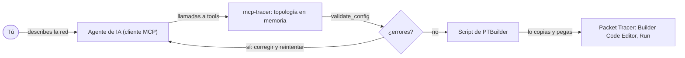

# mcp-tracer

[English](README.md) | **Español**

Un servidor MCP que permite a cualquier agente de IA diseñar topologías de Cisco Packet Tracer. El agente arma la red mediante tools, mcp-tracer la valida y la convierte en un script para la extensión [PTBuilder](https://github.com/kimmknight/PTBuilder), y tú ejecutas ese script en Packet Tracer.

[](https://www.npmjs.com/package/mcp-tracer)
[](https://github.com/aldoogando03-bit/mcp-tracer/actions/workflows/ci.yml)
[](LICENSE)

> mcp-tracer es un proyecto independiente. No está afiliado, respaldado ni patrocinado por Cisco Systems, Inc., ni por PTBuilder o su autor. Consulta el [aviso legal](#aviso-legal).

## Contenido

- [Cómo funciona](#cómo-funciona)
- [Requisitos](#requisitos)
- [Instalación](#instalación)
- [Configuración](#configuración)
- [Tools, resources y prompts](#tools-resources-y-prompts)
- [Ejemplo completo](#ejemplo-completo)
- [Validación y limitaciones](#validación-y-limitaciones)
- [Desarrollo](#desarrollo)
- [Aviso legal](#aviso-legal)
- [Licencia](#licencia)

## Cómo funciona

1. Le describes una red a tu agente de IA en lenguaje natural.
2. El agente llama a las tools de mcp-tracer (`build_topology`, o `add_device`, `add_link`, `configure_device`, `configure_pc`…). El servidor guarda la topología en memoria y rechaza en el momento la entrada inválida: modelos desconocidos, puertos que un modelo no tiene, un puerto usado dos veces, comandos IOS en una PC.
3. `validate_config` informa lo que queda: **errores** (el script fallaría o se abortaría en Packet Tracer) y **advertencias** (puede que no funcione como se espera).
4. `generate_script` devuelve un script de JavaScript para PTBuilder, o `export_script` lo escribe en un archivo `.js`.
5. Pegas el script en **Extensions > Builder Code Editor** en un workspace nuevo y vacío de Packet Tracer y haces clic en **Run**. PTBuilder crea los dispositivos y los cables, aplica la configuración IOS y asigna las direcciones IP de los hosts.



**mcp-tracer no controla Packet Tracer.** Nunca se conecta a él: no puede ver tu workspace, las luces de los enlaces ni la salida de `show`, y no puede modificar una red que ya está en marcha. Solo genera un script, que ejecutas tú. La topología vive en la memoria del servidor y se pierde cuando el cliente MCP reinicia el servidor; usa `save_topology` para conservarla.

## Requisitos

- **Node.js 20 o posterior** (incluye `npx`).
- **Cisco Packet Tracer 8.x o 9.x**, disponible en Cisco Networking Academy.
- **La extensión PTBuilder**, que se instala aparte en Packet Tracer:
  1. Descarga `Builder.pts` del [repositorio de PTBuilder](https://github.com/kimmknight/PTBuilder).
  2. En Packet Tracer abre **Extensions > Scripting > Configure PT Script Modules**.
  3. Haz clic en **Add…** y selecciona `Builder.pts`. (Un usuario de PT 9.0.0 también tuvo que hacer clic en **Run** en ese diálogo).
  4. **Extensions > Builder Code Editor** abre ahora el editor donde se pegan los scripts.
- Un cliente MCP que ejecute servidores stdio locales, como Claude Desktop, Claude Code o Cursor.

## Instalación

No hace falta instalar nada de forma global. Los clientes MCP inician el servidor con:

```bash
npx -y mcp-tracer
```

Si lo ejecutas a mano, el servidor imprime una línea en stderr (`[mcp-tracer] info: v0.1.0 running on stdio`) y luego espera a un cliente MCP por stdin/stdout. Es lo esperado.

### Desde el código fuente

```bash
git clone https://github.com/aldoogando03-bit/mcp-tracer.git
cd mcp-tracer
npm ci
npm run build
```

Luego configura tu cliente para usar `node` con la ruta absoluta a `build/index.js` (ver más abajo).

## Configuración

Todos los clientes de abajo usan la misma entrada de servidor. Reinicia el cliente (o recarga sus servidores MCP) después de editar su configuración.

### Claude Desktop

Abre **Settings > Developer > Edit Config**, o edita el archivo directamente:

- Windows: `%APPDATA%\Claude\claude_desktop_config.json`
- macOS: `~/Library/Application Support/Claude/claude_desktop_config.json`

```json
{
  "mcpServers": {
    "mcp-tracer": {
      "command": "npx",
      "args": ["-y", "mcp-tracer"]
    }
  }
}
```

### Claude Code

```bash
claude mcp add mcp-tracer -- npx -y mcp-tracer
```

Agrega `--scope project` para compartirlo con tu equipo mediante un archivo `.mcp.json` en la raíz del proyecto, que también puedes escribir a mano:

```json
{
  "mcpServers": {
    "mcp-tracer": {
      "command": "npx",
      "args": ["-y", "mcp-tracer"]
    }
  }
}
```

En Windows nativo (no WSL), envuelve `npx` en `cmd /c`: `claude mcp add mcp-tracer -- cmd /c npx -y mcp-tracer`.

### Cursor

Usa el mismo JSON `mcpServers` en `.cursor/mcp.json` dentro de tu proyecto, o en `~/.cursor/mcp.json` para todos los proyectos.

### Desde una copia del código fuente

```json
{
  "mcpServers": {
    "mcp-tracer": {
      "command": "node",
      "args": ["/absolute/path/to/mcp-tracer/build/index.js"]
    }
  }
}
```

### `MCP_TRACER_DIR`

`save_topology`, `load_topology` y `export_script` resuelven las rutas relativas contra `MCP_TRACER_DIR` si está definida y, si no, contra el directorio de trabajo del servidor, que los clientes MCP suelen fijar de forma arbitraria. Un `~` al inicio significa tu carpeta de usuario. Las rutas absolutas siempre funcionan.

Las tools de archivos solo aceptan sus propias extensiones, sin distinguir mayúsculas de minúsculas: `.json` para `save_topology` y `load_topology`, y `.js` o `.txt` para `export_script`. Cualquier otra, como `.cmd` o `.bat`, se rechaza, así que una llamada a una tool nunca puede escribir un archivo ejecutable. También se rechaza una ruta que nombra un directorio (`~`, `.`, `..`, una unidad sola como `C:` o una carpeta existente) o que tiene `:` en el nombre del archivo. Las rutas no están confinadas a `MCP_TRACER_DIR`; restringirlas a esa carpeta es una opción posible a futuro.

```json
{
  "mcpServers": {
    "mcp-tracer": {
      "command": "npx",
      "args": ["-y", "mcp-tracer"],
      "env": { "MCP_TRACER_DIR": "C:\\Users\\you\\Documents\\pt-labs" }
    }
  }
}
```

Con Claude Code: `claude mcp add --env MCP_TRACER_DIR=/home/you/pt-labs mcp-tracer -- npx -y mcp-tracer`.

### Nota para Windows

Si un cliente no logra iniciar el servidor (por ejemplo, `spawn npx ENOENT`), ejecuta `npx` a través de `cmd`:

```json
{
  "mcpServers": {
    "mcp-tracer": {
      "command": "cmd",
      "args": ["/c", "npx", "-y", "mcp-tracer"]
    }
  }
}
```

## Tools, resources y prompts

### Tools

Los nombres de dispositivo no distinguen mayúsculas de minúsculas y deben ser únicos. Un nombre tiene de 1 a 64 caracteres: letras, dígitos, espacios y `. _ ( ) / -`, y empieza con una letra o un dígito (`R1`, `Core SW (1)`); `constructor` y `prototype` están reservados. Los nombres de puerto se pueden abreviar (`Gi0/0` pasa a `GigabitEthernet0/0`, `Fa0/1` pasa a `FastEthernet0/1`). Las coordenadas (`x`, `y`) van de -100000 a 100000. Los argumentos marcados con `?` son opcionales.

Las entradas tienen límites de tamaño: 500 dispositivos y 2000 enlaces por topología, 64 caracteres para nombres de modelo y de puerto, 32 para direcciones y máscaras, y hasta 2000 comandos IOS de 512 caracteres cada uno por llamada y por dispositivo.

| Tool | Qué hace | Argumentos |
|---|---|---|
| `add_device` | Agrega un dispositivo. Los alias se resuelven a claves de PTBuilder (`4331` → `ISR4331`, `WRT300N` → `Linksys-WRT300N`, `PC` → `PC-PT`). Sin x/y, el dispositivo se ubica automáticamente. El resultado lista sus puertos. | `name`, `model`, `x?`, `y?` |
| `add_link` | Conecta dos puertos con un cable. Cada puerto admite un solo enlace. Sin `cable`, el servidor lo deduce. | `dev1`, `port1`, `dev2`, `port2`, `cable?` |
| `remove_device` | Elimina un dispositivo junto con sus enlaces, comandos IOS y configuración IP. | `name` |
| `remove_link` | Elimina el enlace que usa un puerto. | `device`, `port` |
| `rename_device` | Renombra un dispositivo. Sus enlaces y su configuración lo siguen; las líneas `hostname` de IOS no se modifican. | `name`, `new_name` |
| `configure_device` | Agrega comandos IOS a un router, switch o switch multicapa. Se ejecutan en modo de configuración global; las líneas `enable`, `configure terminal`, `end` y `write memory` se descartan y se informan. | `name`, `ios_commands` (arreglo), `replace?` (por defecto `false`: agrega) |
| `configure_pc` | Define la configuración IPv4 de un host en FastEthernet0, estática o por DHCP. Soportado en `PC-PT` y `Server-PT`; `Laptop-PT` y `Printer-PT` se aceptan, pero sin verificar. `ip` acepta `192.168.1.10/24` y `mask` acepta `255.255.255.0` o `/24`. | `name`, `dhcp?` (por defecto `false`), `ip?`, `mask?`, `gateway?`, `dns?` |
| `build_topology` | Reemplaza toda la topología en una sola llamada atómica, con las mismas reglas que las cuatro tools anteriores. Si algún elemento es inválido no cambia nada, y el error indica cuál es. | `devices`, `links?`, `ios?` (`[{name, commands}]`), `pcs?` (como `configure_pc`) |
| `get_topology` | Devuelve la topología en JSON, con las posiciones y los cables que se van a emitir. | ninguno |
| `validate_config` | Informa errores y advertencias, cada uno con un código estable y una solución. | ninguno |
| `generate_script` | Devuelve el script de PTBuilder, más un segundo bloque de texto con las advertencias, si las hay. Los errores de validación lo bloquean. | `force?` (por defecto `false`) |
| `reset_topology` | Borra todos los dispositivos, enlaces y configuraciones. | ninguno |
| `save_topology` | Guarda la topología en un archivo `.json` que `load_topology` puede volver a leer. Agrega `.json` si el nombre no tiene extensión y crea las carpetas que falten. | `path`, `overwrite?` (por defecto `false`) |
| `load_topology` | Reemplaza la topología con una leída de un archivo `.json` escrito por `save_topology` (también sirve un objeto de `get_topology` sin envoltorio). Se valida por completo antes de cambiar nada. Máximo 5 MB. | `path` |
| `export_script` | Escribe el script de PTBuilder en un archivo `.js` o `.txt` (agrega `.js` si el nombre no tiene extensión). Misma validación que `generate_script`. | `path`, `overwrite?` (por defecto `false`), `force?` (por defecto `false`) |

**Cables** (`cable`): `straight`, `cross`, `roll`, `fiber`, `serial`, `console`, `phone`, `coaxial`, `auto`, `octal`, `usb`, `custom_io`. Si lo omites, el servidor elige uno: `straight` entre dispositivos distintos (router o host con switch o hub), `cross` entre dispositivos del mismo tipo (switch con switch, router con router, router con PC, PC con PC), `straight` de un access point a un switch o hub y `cross` a un router o host, `serial` para puertos Serial y `console` para puertos Console/RS232. `auto`, `roll`, `octal`, `usb` y `custom_io` se pasan a PTBuilder tal cual, y su comportamiento ahí no está verificado.

**Modelos.** El catálogo cubre estas claves de PTBuilder:

- Routers: `1841`, `1941`, `2811`, `2901`, `2911`, `ISR4321`, `ISR4331`
- Switches: `2950-24`, `2950T-24`, `2960-24TT`
- Switches multicapa: `3560-24PS` (preferido), `3650-24PS` (ver [limitaciones](#limitaciones))
- Hosts: `PC-PT`, `Server-PT`, `Laptop-PT`, `Printer-PT`
- Otros: `Hub-PT`, `Cloud-PT`, `AccessPoint-PT`, `Linksys-WRT300N`, `5505`, `5506-X`, `7960`

Cualquier otra clave de la tabla de dispositivos de PTBuilder (como `Router-PT` o `Switch-PT`) se acepta, pero sus puertos y cables no se comprueban. Hoy el conjunto más seguro es `2911`, `2960-24TT`, `PC-PT` y `Server-PT`, cuyos puertos más usados están verificados contra fuentes primarias. Los prompts incluidos usan solo esos, más `3560-24PS`.

### Resources

| URI | Contenido |
|---|---|
| `pt://catalog` | Todos los modelos del catálogo: categoría, si aceptan configuración IOS (`configure_device`) o IP de host (`configure_pc`), puertos integrados con un indicador `verified` por puerto, otras claves válidas de PTBuilder sin datos de catálogo, y los tipos de cable. |
| `pt://catalog/{model}` | La entrada de un modelo, por clave o alias: `pt://catalog/2911`, `pt://catalog/4331`. Los nombres de modelo se autocompletan. |

### Prompts

Cada prompt devuelve instrucciones paso a paso para el agente: los argumentos exactos de `build_topology` con el direccionamiento ya calculado, las llamadas a tools siguientes y las comprobaciones a hacer en Packet Tracer. Todos los argumentos son opcionales; los valores inválidos vuelven al valor por defecto, con una nota.

| Prompt | Arma | Argumentos |
|---|---|---|
| `vlan_lab` | Un switch 2960 con PCs por VLAN y enrutamiento entre VLANs opcional | `vlans` (IDs 2-1001 separados por comas, hasta 6; por defecto `10,20,30`), `hosts_per_vlan` (1-4; por defecto `2`), `inter_vlan` (`router-on-a-stick` por defecto, `l3-switch` o `none`) |
| `ospf_lab` | OSPF de un área entre routers 2911, con una LAN de PCs por router | `routers` (2-6; por defecto `3`), `area` (por defecto `0`), `topology` (`chain` por defecto, o `ring` con 3 routers o más) |
| `dhcp_lab` | Un gateway 2911, un switch 2960 y PCs clientes DHCP | `network` (CIDR, /8-/30; por defecto `192.168.10.0/24`), `dhcp_server` (`router` por defecto: pool IOS; `server`: un Server-PT cuyo servicio DHCP configuras a mano), `hosts` (1-20; por defecto `3`) |
| `nat_lab` | PCs internas detrás de un router de borde 2911, un router ISP y un servidor web | `nat_type` (`pat` por defecto, `static` o `dynamic`), `inside_network` (por defecto `192.168.1.0/24`), `outside_network` (por defecto `203.0.113.0/24`) |

En Claude Code los prompts aparecen como comandos de barra, por ejemplo `/mcp__mcp-tracer__vlan_lab`.

## Ejemplo completo

Este es el ejemplo [`small-office-dhcp`](examples/small-office-dhcp/). Las salidas de abajo vienen del propio servidor, que responde en inglés.

**Tú:**

> Arma una oficina pequeña en Packet Tracer: un router, un switch y tres PCs en 192.168.1.0/24. El router debe repartir las direcciones por DHCP.

**El agente** llama a `build_topology`:

```json
{
  "devices": [
    { "name": "R1", "model": "2911" },
    { "name": "S1", "model": "2960-24TT" },
    { "name": "PC1", "model": "PC-PT" },
    { "name": "PC2", "model": "PC-PT" },
    { "name": "PC3", "model": "PC-PT" }
  ],
  "links": [
    { "dev1": "R1", "port1": "GigabitEthernet0/0", "dev2": "S1", "port2": "GigabitEthernet0/1" },
    { "dev1": "PC1", "port1": "FastEthernet0", "dev2": "S1", "port2": "FastEthernet0/1" },
    { "dev1": "PC2", "port1": "FastEthernet0", "dev2": "S1", "port2": "FastEthernet0/2" },
    { "dev1": "PC3", "port1": "FastEthernet0", "dev2": "S1", "port2": "FastEthernet0/3" }
  ],
  "ios": [
    {
      "name": "R1",
      "commands": [
        "hostname R1",
        "ip dhcp excluded-address 192.168.1.1 192.168.1.10",
        "ip dhcp pool OFFICE",
        "network 192.168.1.0 255.255.255.0",
        "default-router 192.168.1.1",
        "exit",
        "interface GigabitEthernet0/0",
        "ip address 192.168.1.1 255.255.255.0",
        "no shutdown",
        "exit"
      ]
    },
    { "name": "S1", "commands": ["hostname S1"] }
  ],
  "pcs": [
    { "name": "PC1", "dhcp": true },
    { "name": "PC2", "dhcp": true },
    { "name": "PC3", "dhcp": true }
  ]
}
```

```text
Topology built: 5 devices, 4 links, 2 IOS configs, 3 host IP configs.
```

No se indicaron cables ni coordenadas, así que el servidor deduce los cables y acomoda los dispositivos en filas. Luego, `validate_config`:

```text
Warnings (1):
- [UNVERIFIED_PORT] S1 (2960-24TT): port names FastEthernet0/2 and FastEthernet0/3 are unverified in Packet Tracer; if PT names a port differently, its addLink fails silently.

No errors: generate_script will run. Warnings point at things that may not work in Packet Tracer.
```

La advertencia es esperable: los puertos `FastEthernet0/2-24` del 2960-24TT siguen la nomenclatura de Cisco, pero por ahora solo `FastEthernet0/1` está confirmado. Por último, `generate_script` devuelve el script:

```js
/* Generated by mcp-tracer v0.1.0 - paste into Extensions > Builder Code Editor and click Run */
addDevice("R1", "2911", 250, 100);
addDevice("S1", "2960-24TT", 250, 250);
addDevice("PC1", "PC-PT", 100, 400);
addDevice("PC2", "PC-PT", 250, 400);
addDevice("PC3", "PC-PT", 400, 400);
addLink("R1", "GigabitEthernet0/0", "S1", "GigabitEthernet0/1", "straight");
addLink("PC1", "FastEthernet0", "S1", "FastEthernet0/1", "straight");
addLink("PC2", "FastEthernet0", "S1", "FastEthernet0/2", "straight");
addLink("PC3", "FastEthernet0", "S1", "FastEthernet0/3", "straight");
configureIosDevice("R1", "hostname R1\nip dhcp excluded-address 192.168.1.1 192.168.1.10\nip dhcp pool OFFICE\nnetwork 192.168.1.0 255.255.255.0\ndefault-router 192.168.1.1\nexit\ninterface GigabitEthernet0/0\nip address 192.168.1.1 255.255.255.0\nno shutdown\nexit");
configureIosDevice("S1", "hostname S1");
configurePcIp("PC1", true);
configurePcIp("PC2", true);
configurePcIp("PC3", true);
```

También devuelve la misma advertencia como un segundo bloque de texto.

### Ejecútalo en Packet Tracer

1. **File > New**, para que el workspace esté vacío. Ejecutar un script en un workspace que ya tiene esos dispositivos los duplica.
2. **Extensions > Builder Code Editor**.
3. Pega el script completo, reemplazando lo que haya en el editor, y haz clic en **Run**.
4. Espera a que todas las luces de los enlaces estén en verde. Los puertos de switch tardan unos 30 segundos.

### Comprueba que funciona

- **PC1 > Desktop > IP Configuration** muestra DHCP con una dirección desde 192.168.1.11 en adelante y gateway 192.168.1.1. Si muestra 169.254.x.x, vuelve a hacer clic en **DHCP** cuando los enlaces estén en verde.
- **PC1 > Desktop > Command Prompt**: `ipconfig`, luego `ping 192.168.1.1` y un ping a la dirección de PC2.
- **R1 > CLI**: `show ip interface brief` (GigabitEthernet0/0 up/up) y `show ip dhcp binding` (una concesión por PC).

## Validación y limitaciones

### Errores y advertencias

La mayoría de los errores se rechazan al llamar a la tool. `validate_config` es la última comprobación antes de generar el script, y además detecta problemas en archivos abiertos con `load_topology`. Los códigos son estables, así que los agentes y los scripts pueden depender de ellos.

Los **errores** indican que el script fallaría o se abortaría en Packet Tracer. Bloquean `generate_script` y `export_script`, salvo que se pase `force: true`.

| Código | Significado |
|---|---|
| `UNKNOWN_MODEL` | El modelo no es una clave de la tabla de dispositivos de PTBuilder. |
| `UNKNOWN_DEVICE` | Un enlace, bloque IOS o configuración IP nombra un dispositivo que no existe. |
| `SELF_LINK` | Un enlace va de un dispositivo a sí mismo (solo es posible en un archivo editado a mano: `add_link` lo rechaza). |
| `PORT_NOT_FOUND` | El modelo no tiene ese puerto (se comprueba en los modelos cuya cantidad de puertos está confirmada). |
| `PORT_KIND_MISMATCH` | Ningún cable puede unir esos dos tipos de puerto, como Serial con GigabitEthernet. |
| `CABLE_INCOMPATIBLE` | El cable indicado no encaja en los puertos. |
| `DUPLICATE_PORT` | Un puerto lo usa más de un enlace. |
| `IOS_ON_NON_IOS` | Comandos IOS en un dispositivo que no es router, switch ni switch multicapa. |
| `PCIP_ON_NON_HOST` | Configuración IP de host en un dispositivo que no es un host. |
| `INVALID_IP` | Una dirección o máscara mal formada. |
| `PCIP_STATIC_INCOMPLETE` | Una configuración estática de host sin `ip` y `mask` a la vez. |

Las **advertencias** indican que el script se ejecuta, pero parte de él puede no funcionar como se espera: `EMPTY_TOPOLOGY`, `UNCATALOGUED_MODEL`, `POWER_3650`, `SERIAL_NEEDS_MODULE`, `CABLE_UNVERIFIED`, `CABLE_SUSPICIOUS`, `UNVERIFIED_PORT`, `ISOLATED_DEVICE`, `PCIP_UNVERIFIED_PORT`, `HOST_STATIC_NO_GATEWAY`, `GATEWAY_NOT_IN_SUBNET`, `DUPLICATE_IP`. Cada mensaje explica el problema y cómo resolverlo.

### Limitaciones

- **Todavía no se ha verificado nada en una ejecución real de Packet Tracer.** La API de PTBuilder se investigó a partir de su código fuente y de la documentación de Cisco ([docs/PTBUILDER_API.md](docs/PTBUILDER_API.md), en inglés). Muchos nombres de puerto, como la mayoría de los puertos del 2960, los del ISR4321/4331, los del 3560/3650 y los puertos de consola, siguen la nomenclatura de Cisco pero no están confirmados. Se señalan con `UNVERIFIED_PORT` y aparecen con `verified: false` en `pt://catalog`. Los [reportes de nombres verificados](https://github.com/aldoogando03-bit/mcp-tracer/issues/new?template=port_verification.yml) son muy bienvenidos.
- **Sin módulos.** La función `addModule` de PTBuilder todavía no está soportada, así que los routers no tienen puertos seriales (usa Ethernet entre routers), y no se pueden agregar uplinks SFP ni adaptadores de corriente para teléfonos IP.
- **Alimentación del 3650-24PS.** En Packet Tracer el 3650-24PS viene sin fuente de alimentación, y PTBuilder no logró agregarle una, así que puede quedar apagado. Usa `3560-24PS`.
- **Fallas silenciosas en PT.** El script no comprueba lo que devuelven `addDevice` y `addLink`, así que un dispositivo o enlace que PT rechace simplemente falta. Los comandos IOS inválidos también fallan en silencio. Una llamada a `configureIosDevice` o `configurePcIp` para un dispositivo que no existe lanza una excepción y detiene el resto del script.
- **Ejecuta cada script una sola vez, en un workspace vacío.** Volver a ejecutarlo, o hacerlo en un workspace que ya tiene dispositivos, los duplica.
- **PTBuilder se instala aparte**, y solo hace lo que ofrece su API. Los servicios de servidor, como el servicio DHCP del Server-PT en `dhcp_lab`, se configuran a mano, y el direccionamiento de hosts es solo IPv4.
- **Sin control en vivo.** mcp-tracer no lee el estado de Packet Tracer (ver [Cómo funciona](#cómo-funciona)).

## Desarrollo

```bash
npm ci
npm run build
```

| Script | Qué hace |
|---|---|
| `npm run build` | Compila `src/` a `build/` (primero limpia). |
| `npm run dev` | Ejecuta el servidor desde el código fuente con `tsx`, sin compilar. |
| `npm start` | Ejecuta `build/index.js` (un servidor stdio que espera a un cliente). |
| `npm run typecheck` | Comprueba los tipos sin generar archivos. |
| `npm test` | Ejecuta las pruebas con Vitest (`npm run test:watch` para el modo watch). |
| `npm run examples` | Compila y luego regenera `examples/*/script.js`. Falla si algún ejemplo tiene errores de validación. `node scripts/build-examples.mjs --check` solo comprueba que los scripts estén al día. |

Para probar el servidor a mano, usa el MCP Inspector: `npx @modelcontextprotocol/inspector node build/index.js`.

[CLAUDE.md](CLAUDE.md) describe la arquitectura, las convenciones y las reglas del generador de scripts. [CONTRIBUTING.md](CONTRIBUTING.md) explica cómo contribuir; consulta también el [changelog](CHANGELOG.md). Estos documentos están en inglés.

## Aviso legal

mcp-tracer es un proyecto comunitario e independiente. **No está afiliado, respaldado ni patrocinado por Cisco Systems, Inc.** Cisco y Cisco Packet Tracer son marcas comerciales o marcas registradas de Cisco Systems, Inc. y/o sus filiales. Aquí se mencionan solo para describir con qué funciona este software.

mcp-tracer tampoco está **afiliado a PTBuilder ni a su autor**. [PTBuilder](https://github.com/kimmknight/PTBuilder) es un proyecto aparte con sus propios términos; su repositorio no declara ninguna licencia. mcp-tracer no incluye ni redistribuye código de PTBuilder. Genera scripts que llaman a las funciones de PTBuilder, y tú instalas PTBuilder por tu cuenta desde su repositorio. Su documentación ([docs/PTBUILDER_API.md](docs/PTBUILDER_API.md), en inglés) describe con sus propias palabras cómo se comporta PTBuilder y enlaza al código fuente de PTBuilder en lugar de copiarlo. mcp-tracer usa los nombres de clave de modelo que acepta la API de PTBuilder (como `ISR4331` o `PC-PT`) solo por interoperabilidad.

Necesitas tu propia copia de Cisco Packet Tracer, obtenida de forma legítima.

## Licencia

[MIT](LICENSE) © 2026 Aldo Ariel Ogando Peña (A-TECH)
