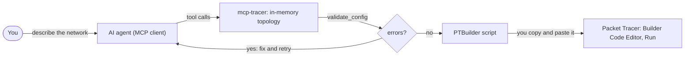

# mcp-tracer

**English** | [Español](README.es.md)

An MCP server that lets any AI agent design Cisco Packet Tracer topologies. The agent builds the network through tools, mcp-tracer validates it and turns it into a script for the [PTBuilder](https://github.com/kimmknight/PTBuilder) extension, and you run that script in Packet Tracer.

[](https://www.npmjs.com/package/mcp-tracer)
[](https://github.com/aldoogando03-bit/mcp-tracer/actions/workflows/ci.yml)
[](LICENSE)

**Website:** [mcp-tracer-web.vercel.app](https://mcp-tracer-web.vercel.app), a step-by-step overview with setup for each AI client.

> mcp-tracer is an independent project. It is not affiliated with, endorsed or sponsored by Cisco Systems, Inc., nor by PTBuilder or its author. See the [disclaimer](#disclaimer).

## Contents

- [How it works](#how-it-works)
- [Requirements](#requirements)
- [Installation](#installation)
- [Configuration](#configuration)
- [Tools, resources and prompts](#tools-resources-and-prompts)
- [Complete example](#complete-example)
- [Validation and limitations](#validation-and-limitations)
- [Development](#development)
- [Disclaimer](#disclaimer)
- [License](#license)

## How it works

1. You describe a network to your AI agent in plain language.
2. The agent calls mcp-tracer tools (`build_topology`, or `add_device`, `add_link`, `configure_device`, `configure_pc`…). The server keeps the topology in memory and rejects invalid input on the spot: unknown models, ports a model doesn't have, a port used twice, IOS commands on a PC.
3. `validate_config` reports what is left: **errors** (the script would fail or abort in Packet Tracer) and **warnings** (it may not work as intended).
4. `generate_script` returns a JavaScript script for PTBuilder, or `export_script` writes it to a `.js` file.
5. You paste the script into **Extensions > Builder Code Editor** in a new, empty Packet Tracer workspace and click **Run**. PTBuilder creates the devices and cables, applies the IOS configuration and sets the host IP addresses.



**mcp-tracer does not control Packet Tracer.** It never connects to it: it can't see your workspace, link lights or `show` output, and it can't change a network that is already running. It only generates a script, which you run yourself. The topology lives in the server's memory and is lost when the MCP client restarts the server; use `save_topology` to keep it.

## Requirements

- **Node.js 20 or later** (`npx` comes with it).
- **Cisco Packet Tracer 8.x or 9.x**, available from Cisco Networking Academy.
- **The PTBuilder extension**, installed separately in Packet Tracer:
  1. Download `Builder.pts` from the [PTBuilder repository](https://github.com/kimmknight/PTBuilder).
  2. In Packet Tracer open **Extensions > Scripting > Configure PT Script Modules**.
  3. Click **Add…** and select `Builder.pts`. (One user on PT 9.0.0 also had to click **Run** in that dialog.)
  4. **Extensions > Builder Code Editor** now opens the editor where you paste the scripts.
- An MCP client that runs local stdio servers, such as Claude Desktop, Claude Code or Cursor.

## Installation

No global install is needed. MCP clients start the server with:

```bash
npx -y mcp-tracer
```

Run by hand, the server prints one line to stderr (`[mcp-tracer] info: v0.1.0 running on stdio`) and then waits for an MCP client on stdin/stdout. That is expected.

### From source

```bash
git clone https://github.com/aldoogando03-bit/mcp-tracer.git
cd mcp-tracer
npm ci
npm run build
```

Then point your client at `node` with the absolute path to `build/index.js` (see below).

## Configuration

Every client below uses the same server entry. Restart the client (or reload its MCP servers) after editing its configuration.

### Claude Desktop

Open **Settings > Developer > Edit Config**, or edit the file directly:

- Windows: `%APPDATA%\Claude\claude_desktop_config.json`
- macOS: `~/Library/Application Support/Claude/claude_desktop_config.json`

```json
{
  "mcpServers": {
    "mcp-tracer": {
      "command": "npx",
      "args": ["-y", "mcp-tracer"]
    }
  }
}
```

### Claude Code

```bash
claude mcp add mcp-tracer -- npx -y mcp-tracer
```

Add `--scope project` to share it with your team through a `.mcp.json` file in the project root, which you can also write by hand:

```json
{
  "mcpServers": {
    "mcp-tracer": {
      "command": "npx",
      "args": ["-y", "mcp-tracer"]
    }
  }
}
```

On native Windows (not WSL), wrap `npx` in `cmd /c`: `claude mcp add mcp-tracer -- cmd /c npx -y mcp-tracer`.

### Cursor

Use the same `mcpServers` JSON in `.cursor/mcp.json` in your project, or in `~/.cursor/mcp.json` for every project.

### Other MCP clients

MCP is an open standard, so mcp-tracer works with any MCP client that can launch local stdio servers; only the place where you register it changes. After that, you ask for the network in plain language and the AI calls the tools itself. There is no special command to type.

These clients read the same `mcpServers` JSON shown for [Claude Desktop](#claude-desktop):

- **VS Code** (GitHub Copilot agent mode): Copilot's portable `~/.copilot/mcp-config.json` takes this JSON. A workspace's `.vscode/mcp.json` and the user `mcp.json` (**MCP: Open User Configuration**) use VS Code's own format instead, shown below.
- **Windsurf / Devin Desktop**: in the Cascade panel, open the **...** menu and click **Open MCP config file** in the MCPs section.
- **Cline**: click the **MCP Servers** icon, open the **Configure** tab and click **Configure MCP Servers**.
- **LM Studio** 0.3.17 or later: in the **Program** tab of the right sidebar, click **Install > Edit mcp.json**.
- **Gemini CLI**: `~/.gemini/settings.json` for every project, or `.gemini/settings.json` in a project. Or run `gemini mcp add -s user mcp-tracer npx -- -y mcp-tracer` (without `-s user` it writes the project file).

**VS Code's own format** has a `servers` key and a `type`:

```json
{
  "servers": {
    "mcp-tracer": {
      "type": "stdio",
      "command": "npx",
      "args": ["-y", "mcp-tracer"]
    }
  }
}
```

**Zed** uses a `context_servers` key in its `settings.json` (**zed: open settings file**):

```json
{
  "context_servers": {
    "mcp-tracer": {
      "command": "npx",
      "args": ["-y", "mcp-tracer"]
    }
  }
}
```

**OpenAI Codex** (CLI and IDE extension) reads `~/.codex/config.toml`, or `.codex/config.toml` in a trusted project:

```toml
[mcp_servers.mcp-tracer]
command = "npx"
args = ["-y", "mcp-tracer"]
```

Or run `codex mcp add mcp-tracer -- npx -y mcp-tracer`.

To set [`MCP_TRACER_DIR`](#mcp_tracer_dir), add an `env` object next to `args` (in Codex, a `[mcp_servers.mcp-tracer.env]` table). On Windows, if a client can't start the server, run `npx` through `cmd /c` as in the [Windows note](#windows-note).

**Model note.** The client's model has to handle tool calling well. Small local models may struggle with large topologies. The built-in prompts (`vlan_lab`, `ospf_lab`, `dhcp_lab`, `nat_lab`) help, because they already contain the computed topology.

**ChatGPT** on the web and on mobile is not supported yet: it only connects to remote MCP servers over HTTPS, and mcp-tracer runs locally over stdio. The ChatGPT desktop app shares Codex's MCP configuration, so the Codex setup above applies to it, or you can add mcp-tracer as a STDIO server under **Settings > MCP servers**.

### From a source checkout

```json
{
  "mcpServers": {
    "mcp-tracer": {
      "command": "node",
      "args": ["/absolute/path/to/mcp-tracer/build/index.js"]
    }
  }
}
```

### `MCP_TRACER_DIR`

`save_topology`, `load_topology` and `export_script` resolve relative paths against `MCP_TRACER_DIR` if it is set, and otherwise against the server's working directory, which MCP clients often set to something arbitrary. A leading `~` means your home directory. Absolute paths always work.

The file tools only accept their own extensions, case-insensitively: `.json` for `save_topology` and `load_topology`, `.js` or `.txt` for `export_script`. Anything else, such as `.cmd` or `.bat`, is refused, so a tool call can never write an executable file. A path that names a directory (`~`, `.`, `..`, a bare drive such as `C:`, or an existing folder) or contains `:` in the file name is refused too. Paths are not confined to `MCP_TRACER_DIR`; restricting them to it is a possible future option.

```json
{
  "mcpServers": {
    "mcp-tracer": {
      "command": "npx",
      "args": ["-y", "mcp-tracer"],
      "env": { "MCP_TRACER_DIR": "C:\\Users\\you\\Documents\\pt-labs" }
    }
  }
}
```

With Claude Code: `claude mcp add --env MCP_TRACER_DIR=/home/you/pt-labs mcp-tracer -- npx -y mcp-tracer`.

### Windows note

If a client fails to start the server (for example `spawn npx ENOENT`), run `npx` through `cmd`:

```json
{
  "mcpServers": {
    "mcp-tracer": {
      "command": "cmd",
      "args": ["/c", "npx", "-y", "mcp-tracer"]
    }
  }
}
```

## Tools, resources and prompts

### Tools

Device names are case-insensitive and must be unique. A name has 1 to 64 characters: letters, digits, spaces and `. _ ( ) / -`, starting with a letter or digit (`R1`, `Core SW (1)`); `constructor` and `prototype` are reserved. Port names can be abbreviated (`Gi0/0` becomes `GigabitEthernet0/0`, `Fa0/1` becomes `FastEthernet0/1`). Coordinates (`x`, `y`) go from -100000 to 100000. Arguments marked `?` are optional.

Inputs have size limits: 500 devices and 2000 links per topology, 64 characters for model and port names, 32 for addresses and masks, and up to 2000 IOS commands of 512 characters each per call and per device.

| Tool | What it does | Arguments |
|---|---|---|
| `add_device` | Add a device. Aliases resolve to PTBuilder keys (`4331` → `ISR4331`, `WRT300N` → `Linksys-WRT300N`, `PC` → `PC-PT`). Without x/y the device is placed automatically. The result lists its ports. | `name`, `model`, `x?`, `y?` |
| `add_link` | Connect two ports with a cable. A port takes one link. Without `cable`, the server infers it. | `dev1`, `port1`, `dev2`, `port2`, `cable?` |
| `remove_device` | Remove a device with its links, IOS commands and IP configuration. | `name` |
| `remove_link` | Remove the link that uses a port. | `device`, `port` |
| `rename_device` | Rename a device. Its links and configuration follow; IOS `hostname` lines are not changed. | `name`, `new_name` |
| `configure_device` | Append IOS commands to a router, switch or multilayer switch. They run in global configuration mode; `enable`, `configure terminal`, `end` and `write memory` lines are dropped and reported. | `name`, `ios_commands` (array), `replace?` (default `false`: append) |
| `configure_pc` | Set a host's IPv4 configuration on FastEthernet0, static or DHCP. Supported on `PC-PT` and `Server-PT`; `Laptop-PT` and `Printer-PT` are accepted but unverified. `ip` accepts `192.168.1.10/24`, `mask` accepts `255.255.255.0` or `/24`. | `name`, `dhcp?` (default `false`), `ip?`, `mask?`, `gateway?`, `dns?` |
| `build_topology` | Replace the whole topology in one atomic call, with the same rules as the four tools above. If any item is invalid nothing changes, and the error names the item. | `devices`, `links?`, `ios?` (`[{name, commands}]`), `pcs?` (as `configure_pc`) |
| `get_topology` | Return the topology as JSON, with the positions and cables that will be emitted. | none |
| `validate_config` | Report errors and warnings, each with a stable code and a fix. | none |
| `generate_script` | Return the PTBuilder script, plus a second text block with any warnings. Validation errors block it. | `force?` (default `false`) |
| `reset_topology` | Delete every device, link and configuration. | none |
| `save_topology` | Save the topology to a `.json` file that `load_topology` reads back. Adds `.json` when the name has no extension and creates missing folders. | `path`, `overwrite?` (default `false`) |
| `load_topology` | Replace the topology with one from a `.json` file written by `save_topology` (a bare `get_topology` object also works). Fully validated before anything changes. 5 MB maximum. | `path` |
| `export_script` | Write the PTBuilder script to a `.js` or `.txt` file (adds `.js` when the name has no extension). Same validation as `generate_script`. | `path`, `overwrite?` (default `false`), `force?` (default `false`) |

**Cables** (`cable`): `straight`, `cross`, `roll`, `fiber`, `serial`, `console`, `phone`, `coaxial`, `auto`, `octal`, `usb`, `custom_io`. Leave it out and the server picks one: `straight` between unlike devices (router or host to switch or hub), `cross` between like devices (switch to switch, router to router, router to PC, PC to PC), `straight` from an access point to a switch or hub and `cross` to a router or host, `serial` for Serial ports and `console` for Console/RS232 ports. `auto`, `roll`, `octal`, `usb` and `custom_io` are passed to PTBuilder as given, and their behaviour there is unverified.

**Models.** The catalog covers these PTBuilder keys:

- Routers: `1841`, `1941`, `2811`, `2901`, `2911`, `ISR4321`, `ISR4331`
- Switches: `2950-24`, `2950T-24`, `2960-24TT`
- Multilayer switches: `3560-24PS` (preferred), `3650-24PS` (see [limitations](#limitations))
- Hosts: `PC-PT`, `Server-PT`, `Laptop-PT`, `Printer-PT`
- Other: `Hub-PT`, `Cloud-PT`, `AccessPoint-PT`, `Linksys-WRT300N`, `5505`, `5506-X`, `7960`

Any other key of PTBuilder's device table (such as `Router-PT` or `Switch-PT`) is accepted, but its ports and cables are not checked. The safest set today is `2911`, `2960-24TT`, `PC-PT` and `Server-PT`, whose most-used port names are verified against primary sources. The built-in prompts use only those, plus `3560-24PS`.

### Resources

| URI | Content |
|---|---|
| `pt://catalog` | Every catalogued model: category, whether it accepts IOS (`configure_device`) or host IP (`configure_pc`) configuration, onboard ports with a `verified` flag per port, other valid PTBuilder keys without catalog data, and the cable types. |
| `pt://catalog/{model}` | One model's entry, by key or alias: `pt://catalog/2911`, `pt://catalog/4331`. Model names auto-complete. |

### Prompts

Each prompt returns step-by-step instructions for the agent: the exact `build_topology` arguments with the addressing already worked out, the follow-up tool calls and the checks to run in Packet Tracer. All arguments are optional; invalid values fall back to the defaults, with a note.

| Prompt | Builds | Arguments |
|---|---|---|
| `vlan_lab` | A 2960 switch with PCs per VLAN and optional inter-VLAN routing | `vlans` (comma-separated IDs 2-1001, up to 6; default `10,20,30`), `hosts_per_vlan` (1-4; default `2`), `inter_vlan` (`router-on-a-stick` default, `l3-switch` or `none`) |
| `ospf_lab` | Single-area OSPF between 2911 routers, one PC LAN per router | `routers` (2-6; default `3`), `area` (default `0`), `topology` (`chain` default, or `ring` with 3+ routers) |
| `dhcp_lab` | A 2911 gateway, a 2960 switch and DHCP-client PCs | `network` (CIDR, /8-/30; default `192.168.10.0/24`), `dhcp_server` (`router` default: IOS pool; `server`: a Server-PT whose DHCP service you configure by hand), `hosts` (1-20; default `3`) |
| `nat_lab` | Inside PCs behind a 2911 edge router, an ISP router and a web server | `nat_type` (`pat` default, `static` or `dynamic`), `inside_network` (default `192.168.1.0/24`), `outside_network` (default `203.0.113.0/24`) |

In Claude Code the prompts appear as slash commands, such as `/mcp__mcp-tracer__vlan_lab`.

## Complete example

This is the [`small-office-dhcp`](examples/small-office-dhcp/) example. The outputs below come from the server itself.

**You:**

> Build a small office in Packet Tracer: one router, one switch and three PCs on 192.168.1.0/24. The router should hand out the addresses by DHCP.

**The agent** calls `build_topology`:

```json
{
  "devices": [
    { "name": "R1", "model": "2911" },
    { "name": "S1", "model": "2960-24TT" },
    { "name": "PC1", "model": "PC-PT" },
    { "name": "PC2", "model": "PC-PT" },
    { "name": "PC3", "model": "PC-PT" }
  ],
  "links": [
    { "dev1": "R1", "port1": "GigabitEthernet0/0", "dev2": "S1", "port2": "GigabitEthernet0/1" },
    { "dev1": "PC1", "port1": "FastEthernet0", "dev2": "S1", "port2": "FastEthernet0/1" },
    { "dev1": "PC2", "port1": "FastEthernet0", "dev2": "S1", "port2": "FastEthernet0/2" },
    { "dev1": "PC3", "port1": "FastEthernet0", "dev2": "S1", "port2": "FastEthernet0/3" }
  ],
  "ios": [
    {
      "name": "R1",
      "commands": [
        "hostname R1",
        "ip dhcp excluded-address 192.168.1.1 192.168.1.10",
        "ip dhcp pool OFFICE",
        "network 192.168.1.0 255.255.255.0",
        "default-router 192.168.1.1",
        "exit",
        "interface GigabitEthernet0/0",
        "ip address 192.168.1.1 255.255.255.0",
        "no shutdown",
        "exit"
      ]
    },
    { "name": "S1", "commands": ["hostname S1"] }
  ],
  "pcs": [
    { "name": "PC1", "dhcp": true },
    { "name": "PC2", "dhcp": true },
    { "name": "PC3", "dhcp": true }
  ]
}
```

```text
Topology built: 5 devices, 4 links, 2 IOS configs, 3 host IP configs.
```

No cables and no coordinates were given, so the server infers the cables and lays the devices out in rows. Next, `validate_config`:

```text
Warnings (1):
- [UNVERIFIED_PORT] S1 (2960-24TT): port names FastEthernet0/2 and FastEthernet0/3 are unverified in Packet Tracer; if PT names a port differently, its addLink fails silently.

No errors: generate_script will run. Warnings point at things that may not work in Packet Tracer.
```

The warning is expected: the 2960-24TT's `FastEthernet0/2-24` follow Cisco's naming, but only `FastEthernet0/1` has been confirmed so far. Finally, `generate_script` returns the script:

```js
/* Generated by mcp-tracer v0.1.0 - paste into Extensions > Builder Code Editor and click Run */
addDevice("R1", "2911", 250, 100);
addDevice("S1", "2960-24TT", 250, 250);
addDevice("PC1", "PC-PT", 100, 400);
addDevice("PC2", "PC-PT", 250, 400);
addDevice("PC3", "PC-PT", 400, 400);
addLink("R1", "GigabitEthernet0/0", "S1", "GigabitEthernet0/1", "straight");
addLink("PC1", "FastEthernet0", "S1", "FastEthernet0/1", "straight");
addLink("PC2", "FastEthernet0", "S1", "FastEthernet0/2", "straight");
addLink("PC3", "FastEthernet0", "S1", "FastEthernet0/3", "straight");
configureIosDevice("R1", "hostname R1\nip dhcp excluded-address 192.168.1.1 192.168.1.10\nip dhcp pool OFFICE\nnetwork 192.168.1.0 255.255.255.0\ndefault-router 192.168.1.1\nexit\ninterface GigabitEthernet0/0\nip address 192.168.1.1 255.255.255.0\nno shutdown\nexit");
configureIosDevice("S1", "hostname S1");
configurePcIp("PC1", true);
configurePcIp("PC2", true);
configurePcIp("PC3", true);
```

It also returns the same warning as a second text block.

### Run it in Packet Tracer

1. **File > New**, so the workspace is empty. Running a script in a workspace that already has these devices duplicates them.
2. **Extensions > Builder Code Editor**.
3. Paste the whole script, replacing anything already in the editor, and click **Run**.
4. Wait until every link light is green. Switch ports take about 30 seconds.

### Check that it works

- **PC1 > Desktop > IP Configuration** shows DHCP with an address from 192.168.1.11 up and gateway 192.168.1.1. If it shows 169.254.x.x, click **DHCP** again once the links are green.
- **PC1 > Desktop > Command Prompt**: `ipconfig`, then `ping 192.168.1.1` and a ping to PC2's address.
- **R1 > CLI**: `show ip interface brief` (GigabitEthernet0/0 up/up) and `show ip dhcp binding` (one lease per PC).

## Validation and limitations

### Errors and warnings

Most mistakes are rejected when the tool is called. `validate_config` is the final check before the script is generated, and it also catches problems in files opened with `load_topology`. Codes are stable, so agents and scripts can rely on them.

**Errors** mean the script would fail or abort in Packet Tracer. They block `generate_script` and `export_script` unless `force: true` is passed.

| Code | Meaning |
|---|---|
| `UNKNOWN_MODEL` | The model is not a key of PTBuilder's device table. |
| `UNKNOWN_DEVICE` | A link, IOS block or IP configuration names a device that doesn't exist. |
| `SELF_LINK` | A link goes from a device back to itself (only possible in an edited file: `add_link` refuses it). |
| `PORT_NOT_FOUND` | The model has no such port (checked for models whose port count is confirmed). |
| `PORT_KIND_MISMATCH` | No cable can join these two kinds of port, such as Serial to GigabitEthernet. |
| `CABLE_INCOMPATIBLE` | The explicit cable doesn't fit the ports. |
| `DUPLICATE_PORT` | A port is used by more than one link. |
| `IOS_ON_NON_IOS` | IOS commands on a device that isn't a router, switch or multilayer switch. |
| `PCIP_ON_NON_HOST` | A host IP configuration on a device that isn't a host. |
| `INVALID_IP` | A malformed address or mask. |
| `PCIP_STATIC_INCOMPLETE` | A static host configuration without both `ip` and `mask`. |

**Warnings** mean the script runs, but part of it may not work as intended: `EMPTY_TOPOLOGY`, `UNCATALOGUED_MODEL`, `POWER_3650`, `SERIAL_NEEDS_MODULE`, `CABLE_UNVERIFIED`, `CABLE_SUSPICIOUS`, `UNVERIFIED_PORT`, `ISOLATED_DEVICE`, `PCIP_UNVERIFIED_PORT`, `HOST_STATIC_NO_GATEWAY`, `GATEWAY_NOT_IN_SUBNET`, `DUPLICATE_IP`. Each message explains the issue and how to fix it.

### Limitations

- **Nothing has been verified in a real Packet Tracer run yet.** The PTBuilder API was researched from its source code and Cisco's documentation ([docs/PTBUILDER_API.md](docs/PTBUILDER_API.md)). Many port names, such as most 2960 ports, the ISR4321/4331 ports, the 3560/3650 ports and console ports, follow Cisco's naming but are unconfirmed. They are flagged by `UNVERIFIED_PORT` and marked `verified: false` in `pt://catalog`. [Reports of verified names](https://github.com/aldoogando03-bit/mcp-tracer/issues/new?template=port_verification.yml) are very welcome.
- **No modules.** PTBuilder's `addModule` isn't supported yet, so routers have no serial ports (use Ethernet between routers), and SFP uplinks and IP phone power adapters can't be added.
- **3650-24PS power.** In Packet Tracer the 3650-24PS ships without a power supply, and PTBuilder could not add one, so it may stay off. Use `3560-24PS`.
- **Silent failures in PT.** The script doesn't check what `addDevice` and `addLink` return, so a device or link that PT refuses is simply missing. Invalid IOS commands also fail silently. A `configureIosDevice` or `configurePcIp` call for a device that doesn't exist throws and stops the rest of the script.
- **Run each script once, in an empty workspace.** Running it again, or in a workspace that already has devices, duplicates them.
- **PTBuilder is a separate install**, and it only does what its API offers. Server services, such as the Server-PT DHCP service in `dhcp_lab`, must be set up by hand, and host addressing is IPv4 only.
- **No live control.** mcp-tracer doesn't read back the state of Packet Tracer (see [How it works](#how-it-works)).

## Development

```bash
npm ci
npm run build
```

| Script | What it does |
|---|---|
| `npm run build` | Compile `src/` to `build/` (cleans first). |
| `npm run dev` | Run the server from source with `tsx`, no build step. |
| `npm start` | Run `build/index.js` (a stdio server that waits for a client). |
| `npm run typecheck` | Type-check without emitting. |
| `npm test` | Run the test suite with Vitest (`npm run test:watch` for watch mode). |
| `npm run examples` | Build, then regenerate `examples/*/script.js`. Fails if an example has validation errors. `node scripts/build-examples.mjs --check` only checks that the scripts are up to date. |

To try the server by hand, use the MCP Inspector: `npx @modelcontextprotocol/inspector node build/index.js`.

[CLAUDE.md](CLAUDE.md) describes the architecture, the conventions and the rules for the script generator. [CONTRIBUTING.md](CONTRIBUTING.md) explains how to contribute; see also the [changelog](CHANGELOG.md).

## Disclaimer

mcp-tracer is an independent, community project. It is **not affiliated with, endorsed or sponsored by Cisco Systems, Inc.** Cisco and Cisco Packet Tracer are trademarks or registered trademarks of Cisco Systems, Inc. and/or its affiliates. They are used here only to describe what this software works with.

mcp-tracer is also **not affiliated with PTBuilder or its author**. [PTBuilder](https://github.com/kimmknight/PTBuilder) is a separate project with its own terms; its repository declares no license. mcp-tracer does not include or redistribute any PTBuilder code. It generates scripts that call PTBuilder's functions, and you install PTBuilder yourself from its repository. Its documentation ([docs/PTBUILDER_API.md](docs/PTBUILDER_API.md)) describes how PTBuilder behaves in its own words and links to PTBuilder's source instead of copying it. mcp-tracer uses the model-key names that PTBuilder's API accepts (such as `ISR4331` or `PC-PT`) only for interoperability.

You need your own, properly obtained copy of Cisco Packet Tracer.

## License

[MIT](LICENSE) © 2026 Aldo Ariel Ogando Peña (A-TECH)
